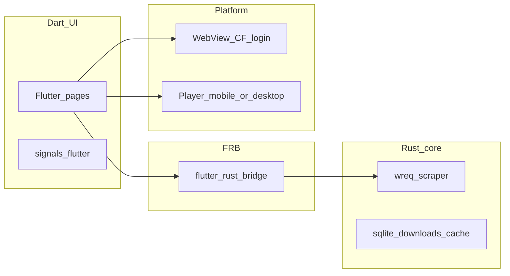

# Han1meViewer

Cross-platform client built with Flutter. Visual assets, bundled resources, and product design follow the lineage of **Han1meViewer** and **Han1meViewer-Remastered**. This repository is an independent multi-platform rewrite and does not speak for the original authors.

## Architecture

- **UI (Dart)** — Flutter interface with `signals_flutter` for reactive state. Adaptive navigation for phone and desktop widths.
- **Core (Rust)** — Business logic lives in the `rust/` crate and is exposed to Dart through `flutter_rust_bridge`: HTTP with `wreq` (Chrome/Android-style emulation), HTML scraping, cookies, mirrors/DoH/proxy settings, SQLite persistence, LRU cache, and resumable downloads.
- **Cloudflare & sign-in** — `flutter_inappwebview` on iOS, Android, macOS, and Windows; `desktop_webview_window` on Linux. Challenge and login flows sync cookies and user agent back into the Rust client.
- **Playback** — `better_player_plus` on iOS and Android; `media_kit` (libmpv) on macOS, Windows, and Linux.
- **Local storage** — Application-support directories for cache, database, downloads, and WebView data; platform hooks mark sensitive folders as non-backup where applicable (e.g. iOS).
- **Platform priority** — iOS, then Android, macOS, Windows, and Linux.
- **macOS distribution** — App Sandbox is **disabled** in this project (not suitable for Mac App Store as-is). Data lives under the user’s Application Support folder instead of a sandbox container.

## Technical details — on-disk data

At startup, Dart calls `path_provider`’s `getApplicationSupportDirectory()` and passes that path to Rust as **`root`**. All durable app data is stored under `root` (not in the user’s public Downloads/Documents folders unless the user exports a file via a system picker). Application ID / bundle identifier: **`com.han1meviewer.flutter`**.

**Layout under `root`** (created by the Rust core):

| Path | Purpose |
|------|---------|
| `db/hvf.db` | SQLite: cookies/session, settings (KV), download jobs, play history, etc. |
| `cache/images/` | Image LRU cache |
| `cache/http/` | Page / HTTP cache |
| `downloads/` | Default video download location (in-app; export uses platform pickers) |
| `webview/` | Windows WebView2 profile directory; size stat for “built-in browser data” |
| `tmp/` | Temporary files |

**Typical `root` locations by platform** (exact paths may vary with OS version, multi-user, or locale):

| Platform | Typical `root` |
|----------|----------------|
| iOS | App sandbox: `Library/Application Support/…` (under the app container). The whole tree is marked **excluded from iCloud backup**. |
| Android | Internal app storage: `/data/user/0/com.han1meviewer.flutter/files/` (other apps cannot read without root). |
| macOS | `~/Library/Application Support/com.han1meviewer.flutter/` (no App Sandbox container). |
| Windows | `%APPDATA%\Han1meViewer\HaVF\` (from the executable `VERSIONINFO` / `path_provider`). |
| Linux | `$XDG_DATA_HOME/com.han1meviewer.flutter/` (default `~/.local/share/com.han1meviewer.flutter/`). |

**WebView storage:** On **Windows**, the embedded browser profile is explicitly under `root/webview/`. On **iOS, Android, and macOS**, `flutter_inappwebview` may keep additional engine caches outside `webview/`; clearing storage in settings also invokes the WebView cache APIs where applicable. **Linux** uses a separate desktop WebView window; cookies and user agent are still synced into the Rust client after login or challenge flows.

At runtime, the resolved path is available through the Rust API `dataRoot()` (also exposed to Dart).
